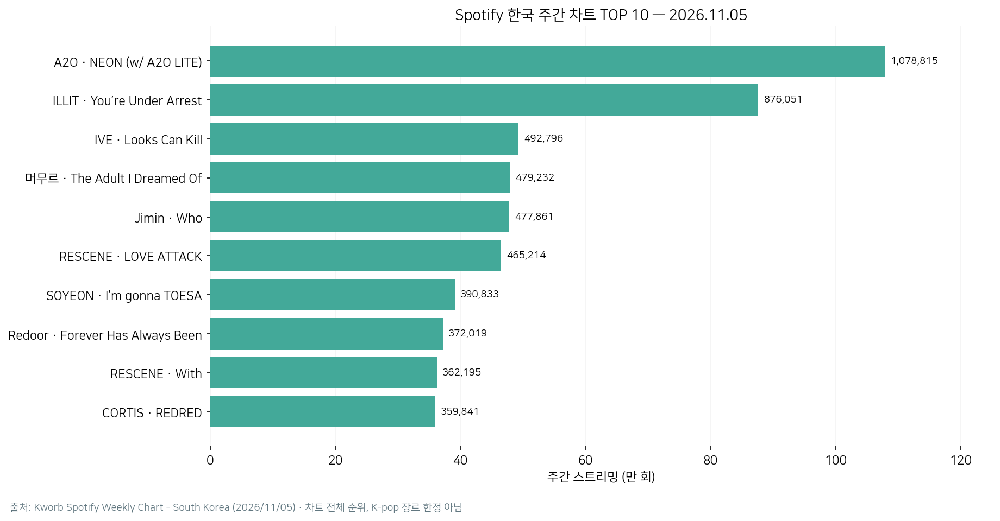
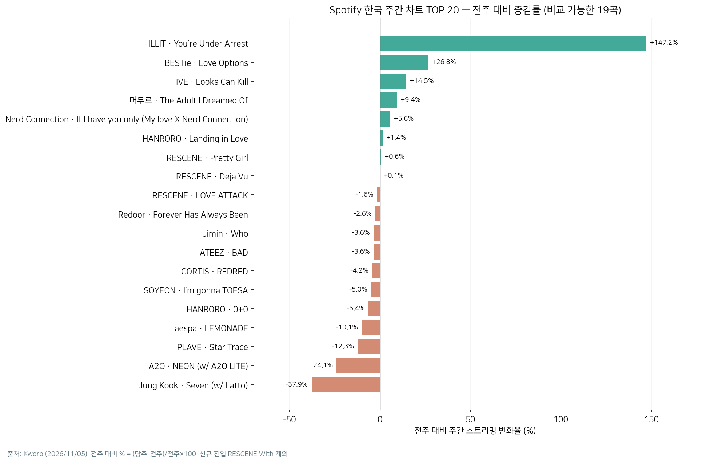
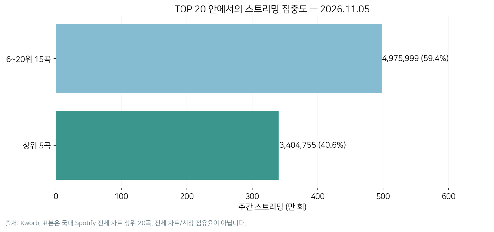

# MBC 데이터 분석 과제 포트폴리오 — K-pop × Olist (2026-11-09)

이 폴더는 기존 포트폴리오와 분리한 **과제 전용 정적 웹페이지**입니다.

## 웹에서 바로 보기

- GitHub 파일: [index.html](./index.html)
- 배포된 GitHub Pages 주소: https://choisunghwan1004-dev.github.io/postfolio/mbc-kpop-olist-20261109/
- [과제 제출용 ZIP 내려받기](https://drive.google.com/file/d/1gORcec-W3NF6R7m894lCxQ_TqMIr97RB/view?usp=drivesdk)
- [MBC 과제 제출 폴더](https://drive.google.com/drive/folders/1qCloI4HiTNBCypiVgafhlMQNpVIimIx8)

**게시 상태:** GitHub Pages는 `main / (root)`로 설정되었고 배포 작업 성공 기록을 확인했습니다. 브라우저에 오래된 화면이 남아 있다면 새로고침하십시오. 원래 포트폴리오의 루트 `index.html`은 수정하지 않았습니다.

## 실제 데이터 실행 결과 · 2026-11-09

기존 K-pop 저장소 `dominickim77-ui/mbc-kpop-data`가 현재 404여서, **대체 원자료**인 [Kworb Spotify 한국 주간 차트 (2026-11-05)](https://www.kworb.net/spotify/country/kr_weekly.html)의 상위 20곡을 분석했습니다. 이는 **한국 Spotify 전체 음악 차트**로 K-pop 장르만 선별한 것이 아니며, 원래 Spotify·YouTube 5곡 비교 데이터와 동일하지 않습니다.

- **분석 대상:** TOP 20, 20곡 · 주간 재생수 8,380,754회 · 상위 5곡 점유율 40.63% (TOP20 내부 비중)
- **전주 비교:** 19곡 · 신규 진입 1곡은 변화율 계산에서 제외
- **검증 기록:** 11개 코드 셀 실행 및 데이터 결측·중복·수치 계산 점검 (사용자 PC Streamlit 모델 예측 확률 CSV는 미제출)
- **최신 제출 ZIP:** [노트북·CSV·PNG 7장·보고서](https://drive.google.com/file/d/1QcId4pkSIB51OMdgqctqUupA46JQeauL/view?usp=drivesdk)

### GitHub에서 직접 볼 수 있는 파일

- [실습 노트북 (.ipynb)](KPOP_Olist_데이터분석_실습.ipynb) — 코드와 텍스트 출력 포함, 삽입된 대용량 이미지 출력은 제거하고 아래 PNG로 별도 등록
- [차트 폴더 — PNG 7장](charts/)
- [Spotify 20곡 CSV](data/spotify_kr_weekly_2026-11-05_top20.csv) · [검증 집계 JSON](data/spotify_kr_analysis_summary.json)
- [Olist 출처별 사실표](data/olist_verified_facts.csv)
- [Olist 차트 4개 재생성 Python 코드](generate_charts.py) · [Spotify 차트 3개 재생성 Python 코드](generate_spotify_charts.py) · [Streamlit 감성분석 소스](streamlit_app.py)
- [모델 다운로드 코드](다운로드_모델.py) · [검증 코드](실제예측_검증.py) · [설치 목록](requirements_tensorflow.txt)
- [실제 데이터 분석 결과 보고서](Kpop_실제데이터_분석결과.md) · [과제 제출 안내·최종 검수](README_과제제출.md)

### 차트 미리보기

과제 웹페이지에서 모든 7개 차트와 해설을 확인할 수 있습니다: [GitHub Pages](https://choisunghwan1004-dev.github.io/postfolio/mbc-kpop-olist-20261109/).

**중요:** 원본 GitHub 코드가 공개되지 않아 원래 분석 프로젝트의 CSV 전체 복원 및 API 재실행은 아직 완료되지 않았습니다. 대체 차트는 출처와 날짜가 다른 별도의 학습용 실측 분석이며, YouTube 영상 조회수는 신규 수집하지 않았습니다.

## Olist 차트 4개와 근거 (Spotify 3개는 위 실측 분석)

| 차트 | 질문 | 결과 | 원출처 |
|---|---|---|---|
| 배송 / 리뷰 | 지연 배송의 리뷰는 얼마나 다른가? | 제때 4.30점, 지연 2.57점 | F14 |
| 모델 정확도 | 딥러닝은 항상 더 정확한가? | Bigram 92.6%, 딥러닝 92.4% | F23~F25 |
| 지역별 주문 | 주문이 집중된 지역은? | SP 42.0%, RJ 12.8%, MG 11.8% | F08 |
| 판매자 유형 | 가장 큰 판매자 유형은? | 신규 성장 947명 | F27 |

원 수치: [Olist 분석 사실표](https://github.com/journal-izm/Olist-Data-Analysis/blob/main/rag/olist_facts.csv)

## 분석 프로젝트

- **K-pop DATA LAB (과거 분석 자료 확인 가능)** — [2026-11-06 K-pop × Olist 발표자료](https://docs.google.com/presentation/d/1hm6ltewG0AlyjkrerB3e1jDjrKCcMj75/edit?usp=drivesdk)에는 이전에 확인한 5곡 비교 스냅샷(Spotify 2026-10-01 주간 / YouTube 2026-10-07 수집)과 분석기법이 수록되어 있습니다. **현재 최신 데이터가 아니라 과거 수집 자료**입니다. [원본 GitHub](https://github.com/dominickim77-ui/mbc-kpop-data)는 2026-11-09 재접속 시 404로, 비공개 전환·이동·삭제 여부는 확인되지 않았습니다. 원본 CSV를 다시 확보하기 전까지 최신값으로 업데이트하지 않습니다.
- [Olist Data Analysis](https://github.com/journal-izm/Olist-Data-Analysis) — README, F01~F35 사실표, 감성분석 Gradio 노트북과 모델 파일 목록을 검토.
- [Olist 딥러닝 모델 예제](https://github.com/journal-izm/Olist-Data-Analysis/blob/main/STEP2_Model_Serving/01_sentiment_demo_gradio.ipynb) — Keras 감성분석/Tokenizer, 입력 길이 50, post padding 및 truncating.

## 포함 / 미포함

- **이 GitHub 폴더:** 데이터저널리즘 요약 HTML, Olist 4개 + Spotify 3개 차트의 PNG 총 7장, 실습 노트북·Python 소스·CSV 및 로그축 vs 표준화 비교, 검증·출처 표시.
- **Drive 제출 ZIP:** 연습 노트북 `.ipynb` 1개, 차트 `.png` 7개, Streamlit 감성분석 소스, 모델 다운로더, Windows 실행 파일, 보고서·검수 기록. GitHub용 [Spotify 재생성 코드](generate_spotify_charts.py)는 별도로 제공됩니다.
- **공개 저장소에 포함하지 않음:** `.venv`, `.pkl`, `.keras`, 개인 비밀키, 개인 PC 경로. 실제 모델 추론 확률값 CSV는 미제출.

**표현 주의:** 차트는 Olist 저장소의 기존 집계 사실을 새로 시각화한 것이며, 주문 전체를 직접 재계산하거나 통계적 인과관계를 입증한 결과가 아닙니다. 웹페이지는 정적 프레젠테이션이며 TensorFlow 추론을 실행하지 않습니다.

---
원본 포트폴리오의 UI·기능·파일은 수정하지 않고 `mbc-kpop-olist-20261109/` 새 하위 폴더만 추가했습니다.
